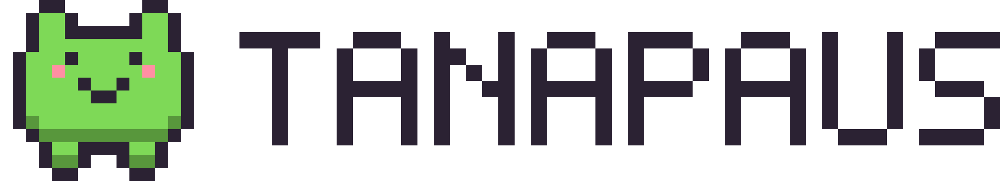
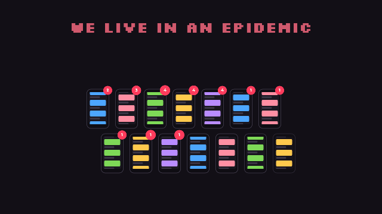

<p align="center"></p>

# Tanapaus: the phone-free pet box

**We live in an epidemic where attention is being hijacked by phones, social media and screens.** Tanapaus turns putting the phone away into a game you play together.

Everyone docks their phone in a box with one switch per slot. While every phone stays put, a shared pixel pet grows and evolves on the box's screen. If anyone picks their phone up, everyone loses: the pet loses a heart, and the screen shows who did it.

<p align="center"></p>

The full two-minute tour is in [`docs/tour/index.html`](docs/tour/index.html): open it in a browser (or through GitHub Pages) and press **F** for fullscreen.

## How it plays

- **Pick an egg.** A new pet starts as an egg, and you choose its time: 15, 30, 60 or 90 minutes. That time is the goal of every session for this pet. Longer eggs hatch rarer animals.
- **Everyone docks.** It's a team game: each slot has a microswitch, and when every player's phone is in, a 10-second countdown starts the session. No buttons.
- **Count down.** The timer counts down to the goal while the pet earns XP. The egg hatches into one of 13 animals and grows from Baby to Elder.
- **Bonus round.** At the goal the box shows *GOAL COMPLETE!*. Finish then, or keep going to double the time for an extra life.
- **Don't get busted.** Lifting a phone mid-session ends it for everyone: a lost heart, and that player goes on the wall of shame. Lose every heart and the pet dies.
- **Win or lose together.** The team has a daily minimum of docked minutes; missing it costs one heart.
- **Sleep at night.** From 22:00 to 07:00 the pet sleeps and no session runs. The phones should be away anyway.
- **You decide when a new pet starts:** after a pet dies, or any time between sessions with *New pet*.

The rules, numbers and odds are in [docs/game-design.md](docs/game-design.md).

## The companion app

The box serves a small web app over Wi-Fi: scan the QR code behind *Link phone* on the box. There's no app store and no account. Every player's phone shows:

- the pet, its hearts and the live session timer, with progress bars for the goal and the bonus round
- the egg picker, player names and settings (PIN-protected; the PIN is on the box)
- the group's minutes today, the wall of shame and lifetime stats
- a calendar of phone-free days, badges, and the collection of animals the box has hatched
- a friends view to compare pets and phone-free minutes (simulated on the phone for now)

The app is Preact + TypeScript, built into one gzipped HTML file that the firmware embeds. The JSON API it uses is documented in [docs/api.md](docs/api.md).

## Hardware

| Part | |
|------|---|
| Arduino GIGA R1 WiFi | main board |
| Arduino GIGA Display Shield | 800x480 touchscreen |
| 4 lever microswitches | one per phone slot |
| Piezo buzzer | optional |

Parts, wiring and pins are in [docs/hardware.md](docs/hardware.md).

## Try it on your computer

The game logic is plain C++17 and runs on your computer too.

```bash
make test
```

```bash
make sim && ./build/petsim
```

Simulator keys: `1`–`4` dock/lift phones, `s` start, `c` cancel, `e` emergency pass, `f` finish, `Enter` OK, `t` cycle the egg's time (fresh egg only), `w` time warp (×1/×60/×600), `r` reset the pet, `q` quit. The simulator saves to `petsim.sav` in the current folder. Quitting mid-session counts as pulling the plug.

The companion app runs against a simulated box (PIN `1234`):

```bash
npm --prefix app install
```

```bash
MOCK_CLOCK=1 MOCK_SPEED=60 npm --prefix app run mock
```

```bash
npm --prefix app run dev
```

## Build and flash the box

1. Wire it up following [docs/hardware.md](docs/hardware.md), then check the switches with `firmware/tools/switch_test/switch_test.ino` (Arduino IDE).
2. **One time only:** flash the core's *STM32H747_System → QSPIFormat* example from the Arduino IDE and answer the prompts. This creates the flash partitions the pet is saved to (partition 4). Without it the game still runs, but it doesn't save.
3. Install [PlatformIO](https://platformio.org/install/cli). If you changed the app, rebuild it and embed it in the firmware:

```bash
npm --prefix app run build && python3 firmware/tools/embed_app.py
```

4. Flash:

```bash
pio run -d firmware -t upload
```

5. Give the box your Wi-Fi from the touchscreen (Stats → Settings), or over USB:

```bash
python3 firmware/tools/set_wifi.py
```

Flashing restarts the board. During a session that counts as pulling the plug and costs a heart, so flash between sessions.

The display uses LVGL 8.3 via the core's `Arduino_H7_Video` and `Arduino_GigaDisplayTouch` libraries; its configuration is in `firmware/include/lv_conf.h`. Pins are set in `firmware/src/config.h`.

## Layout

```
lib/petcore/   Game rules, pet, eggs and species, save format, sprites, messages (portable C++17)
firmware/      PlatformIO project for the GIGA: hardware, LVGL screens, Wi-Fi, web server
app/           Companion web app (Preact) and a mock box for development
sim/           Terminal simulator using the same petcore code
test/          Host unit tests for petcore
docs/          Game design, API, hardware, brand, the tour
```

## Contributing

Pull requests are welcome, including ports to other hardware. See [CONTRIBUTING.md](CONTRIBUTING.md).

## License

- **Code** (firmware, game core, app, tools): [GPL-3.0-or-later](LICENSE). Use it, change it, sell it; if you distribute something built on it, share its source under the same license.
- **Docs and artwork** (`docs/`, sprites, the tour): [CC BY-SA 4.0](https://creativecommons.org/licenses/by-sa/4.0/).
- **The Tanapaus name and logo** are trademarks and aren't covered by either license; give your own builds and forks their own name.

Details are in [NOTICE.md](NOTICE.md).
